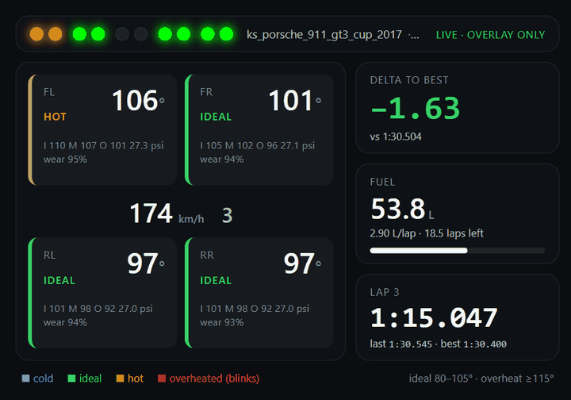

# tyrelight

**Assetto Corsa telemetry overlay that turns your MOZA wheel's rev LEDs into tyre-condition lights.**

Reads the Assetto Corsa shared-memory API, streams it over WebSocket, renders a browser
overlay (tyre temps, fuel, delta to best lap) and, instead of showing revs, paints each
tyre's condition onto the RPM LED bar of a MOZA wheel:

| LED colour | Tyre core temp | Meaning |
|---|---|---|
| 🔵 blue | below the window | cold, no grip yet |
| 🟢 green | inside the window | ideal, push |
| 🟠 amber | just above the window | hot, ease off |
| 🔴 red, blinking | well above the window | overheated, back off now |



The LED strip at the top-left of the overlay mirrors the wheel exactly, so you can see
what the bar is doing in a stream or a GIF.

## LED layout

Looking down at the wheel, fronts sit on the outside, rears inboard, and the centre
LEDs are spare:

```
 FL  FL  RL  RL  ·  ·  RR  RR  FR  FR      (10-LED wheel)
```

The centre LEDs turn **white when fuel drops below two laps**. Wheels with 12 LEDs get
three per tyre, and so on (`--leds N`).

## Requirements

* Windows (Assetto Corsa's shared memory only exists there)
* Python 3.10+
* Assetto Corsa (original; ACC has a different memory layout)
* A MOZA base + wheel with an RPM LED bar (CS, KS, FSR, GS, ES on R9/R12/R16/R21...).
  R3/R5 bases with the bundled ES wheel are supported in a reduced "severity bar" mode
  because that generation cannot take per-LED colours.

## Quick start

```powershell
git clone https://github.com/coen96297-cmyk/tyrelight
cd tyrelight
pip install -r requirements.txt

# Try it without the game or the wheel:
python -m tyrelight --demo --no-leds
# then open http://127.0.0.1:8000/?bg=1

# The real thing:
python -m tyrelight
```

Close **MOZA Pit House** (or at least stop it driving the LEDs) before running with a
wheel: both talk to the base over the same serial port, and Pit House will fight for the
LEDs. tyrelight puts the bar back into telemetry mode and clears it on exit.

Add the overlay to OBS as a *Browser Source* pointing at `http://127.0.0.1:8000/`. The page
background is transparent; append `?bg=1` for a solid backdrop while tuning and
`?scale=1.5` to enlarge it.

## Options

```
python -m tyrelight [--demo] [--port COM5] [--leds 10] [--legacy] [--no-leds]
                    [--config config.json] [--ws-port 8765] [--http-port 8000] [--hz 20] [-v]
```

* `--port` is auto-detected from the MOZA USB vendor id (0x346E); pass it if you have more
  than one base plugged in.
* `--legacy` forces the R3/R5 ES-wheel protocol (auto-detected from the port name when possible).
* `-v` logs every serial frame in hex, handy when checking the wheel responds.

### Temperature windows

Thresholds live in `config.json`, keyed by AC's tyre compound name. An exact compound name
(`"Soft (S)"`) wins over a family keyword (`slick`, `semislick`, `street`, `vintage`, `rain`):

```json
"slick": { "cold_below": 80, "hot_above": 105, "overheat_above": 115 }
```

Ideal is everything between `cold_below` and `hot_above`. Tune per car; AC's core
temperature is what the sim uses for grip, so these numbers matter more than the
inner/middle/outer surface temps shown in the overlay's small print.

## How it works

```
Assetto Corsa ──(shared memory, 20 Hz)──▶ tyrelight/server.py ──▶ ws://127.0.0.1:8765 ──▶ overlay/
                                              │
                                              └──(USB serial, 115200 baud)──▶ MOZA base ──▶ wheel LEDs
```

* `tyrelight/ac_shared_memory.py` maps AC's `acpmf_physics`, `acpmf_graphics` and
  `acpmf_static` pages with ctypes.
* `tyrelight/tyres.py` classifies each tyre's core temperature and lays the four
  conditions out across however many LEDs the wheel has.
* `tyrelight/moza.py` speaks the MOZA serial protocol: `telemetry-mode` puts the bar under
  external control, `telemetry-rpm-colors` sets each LED's RGB, and `send-rpm-telemetry`
  sends the bitmask of lit LEDs. Colours are only re-sent when a tyre changes state, the
  bitmask goes at up to 20 Hz (overheated tyres blink at 2 Hz).
* `tyrelight/delta.py` builds the delta-to-best from AC's normalised track position, since
  original AC does not publish one. `tyrelight/fuel.py` averages the last five laps for
  laps-remaining.
* `tyrelight/demo.py` fakes a lap of the Nordschleife so everything can be tried on the desk.

Run the tests with `python -m pytest`. They check the serial frames byte-for-byte against
captures published by the projects below.

## Credits

The MOZA serial protocol is not public. This project stands on the reverse engineering in
[Lawstorant/boxflat](https://github.com/Lawstorant/boxflat) (protocol notes and the
command table in `serial.yml`) and [francisdb/moza-rev](https://github.com/francisdb/moza-rev)
(byte-stuffing, the legacy ES path, and the test vectors). If you just want RPM LEDs
inside SimHub, look at [giantorth/AZOM](https://github.com/giantorth/moza-simhub-plugin).

## License

MIT
